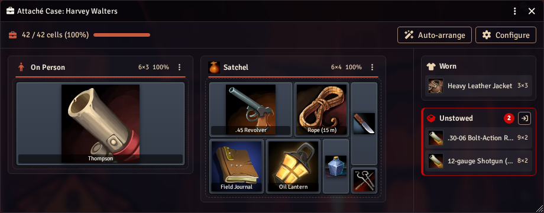
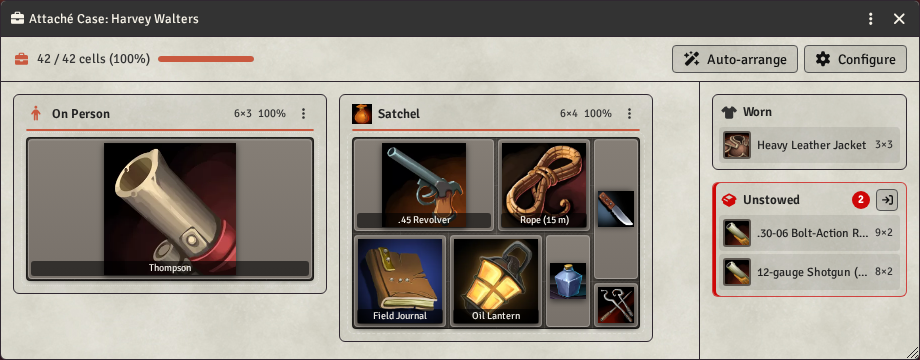

# Attaché Case

A briefcase-style grid inventory for **Foundry VTT v14**, for **Call of Cthulhu 7th Edition** and
**Delta Green**. Every item takes a number of cells. Players fit their gear into a grid, drag it around
and rotate it to make room. The GM decides how big each item and each bag is.





## Features

- **Grid inventory**: items have a size in cells (a revolver is 3x2, a rifle 9x2, a first aid kit 2x2).
- **Drag, drop and rotate**: the drop preview turns green where the item fits and red where it does not.
- **Several grids per actor**: an "On Person" grid (pockets, belt) plus any number of bags and cases.
  A bigger backpack means more room.
- **12 ready-made containers**, from a Belt Pouch (3x2) to a Steamer Trunk (14x8).
- **Default sizes** for the weapons, armor and gear in both systems' compendiums, plus guesses from the
  item name (English and Brazilian Portuguese) and type for everything else.
- **Nothing is lost**: items that do not fit wait in the **Unstowed** tray.
- **Worn armor** goes in a separate **Worn** strip and takes no grid space.
- **Hand items over** by dragging them into another character's open case, or with **Give to…**.
- Light and dark themes. English and Brazilian Portuguese.

## Installation

In Foundry's setup screen: **Add-on Modules → Install Module**, paste this URL into **Manifest URL**
and click **Install**:

```
https://github.com/ThePacMan101/attache-case-foundryvtt/releases/latest/download/module.json
```

Then enable **Attaché Case** in your world (**Game Settings → Manage Modules**).

## For players

**Open your case** in any of these ways:

- the **⋮** menu at the top of your character sheet → **Attaché Case**;
- right-click the actor in the **Actors** sidebar → **Attaché Case**;
- press **`I`** (your assigned character, or the selected token's actor; press again to close).

**Move and rotate**

| Action | How |
|---|---|
| Move an item | Drag it to a free spot, in any of your grids |
| Rotate while dragging | `R`, right-click or mouse wheel |
| Cancel a drag | `Escape` (or drop on an invalid spot: the item goes back) |
| Rotate in place | Hover the item and press `R`, or right-click → **Rotate** |
| Move with the keyboard | Click (or `Tab` to) an item, then use the arrow keys; `Enter` opens it |
| Open the item sheet | Double-click it |

**Worn and Unstowed**

- Drop armor on **Worn** to wear it. Drag it back into a grid to take it off.
- Drop an item on **Unstowed** to take it out of the grid. New items that do not fit also land there.
- The arrow button on the Unstowed header puts unstowed items into free spots, without moving
  anything else. **Auto-arrange** (top of the window) repacks everything.

**Right-click an item** for: Open, Rotate, Unstow, Wear / Take Off, Give to….

**Give an item to someone**: drag it into another character's open case, or right-click →
**Give to…**. You can give to your own characters and to any character a player owns. If you do not
own the target, a GM must be connected.

**Add items**: drag an item from the Items sidebar, a compendium or a sheet onto a cell. This adds a
copy there, just like dropping it on a character sheet.

Characters you can only observe open in read-only mode.

## For Game Masters

- **Item size**: right-click an item in the case → **Inventory Size**, or the **⋮** menu of the item
  sheet. Set width and height in cells. The dialog shows the default size and where it comes from;
  **Reset to Default** brings it back.
  In the same dialog: **Takes no space** (the item is ignored) and **Container** (the item becomes a
  bag with its own grid).
- **Exclude / Include** (right-click): an excluded item takes no space. Excluded items are listed under
  **Not carried**, visible only to GMs. "Unarmed" attacks are excluded by default.
- **Make Container…** (right-click): turn any item into a bag.
- **Configure** (top of the case window), per actor:
  - the **On Person** grid size (or the world default; 0 columns or rows = no grid);
  - the actor's containers: resize, remove, or **Add Container** from the 12 presets.
- **Container menu** (right-click a grid's title or its **⋮** button): Resize…, Open Sheet, Remove
  Container. A removed container's contents move to free space, or to Unstowed.
- **Compendium**: each system gets an **Attaché Case: Containers** compendium with the same 12 bags.
  Drag one onto a case or a character sheet.
- Upgrading a character's storage means adding a bigger bag (and removing the old one, if you like).
- Right-click → **Delete** removes an item from the actor (with confirmation).

## Settings

| Setting | Scope | Default | What it does |
|---|---|---|---|
| Body Grid Columns / Body Grid Rows | World | 5 / 3 | "On Person" grid for actors without their own size |
| Place New Items | World | On | New items go to the first free spot |
| Worn Armor | World | On | Shows the Worn strip |
| Players Edit Sizes | World | Off | Players can change the size of their own items |
| Cell Size | Client | 48 px | Size of one cell on your screen (32 to 80) |
| Show Item Names | Client | On | Names on the item tiles |

The **`I`** key can be changed in **Configure Controls** ("Open Attaché Case").

## Default sizes

One cell is about 10 cm. Long things lie horizontally. Some examples:

| Item | Size | Item | Size |
|---|---|---|---|
| Derringer, ammo, small gear | 1x1 | Knife, flashlight, radio | 2x1 |
| Handgun, revolver | 3x2 | Magnum, heavy pistol | 4x2 |
| Modern SMG | 4x3 | Thompson | 6x3 |
| Shotgun, carbine, bow | 8x2 | Rifle | 9x2 |
| Book, first aid kit, camera | 2x2 | Tome | 2x3 |
| Kevlar / soft vest | 4x3 | Body armor | 4x4 |

Anything else falls back to its type: weapon 2x2, armor 3x3, book/tome 2x2, other gear 1x1.
Skills, spells, bonds and other non-physical items are ignored. The GM can override any item.

Ready-made containers (columns x rows):

| Container | Size | Container | Size |
|---|---|---|---|
| Belt Pouch | 3x2 | Backpack | 8x6 |
| Coat Pockets | 4x2 | Gun Case | 12x3 |
| Tactical Vest | 6x3 | Suitcase | 10x6 |
| Satchel | 6x4 | Military Rucksack | 10x7 |
| Doctor's Bag | 6x5 | Duffel Bag | 12x6 |
| Attaché Case | 9x5 | Steamer Trunk | 14x8 |

## API for macros and modules

```js
const api = game.modules.get("attache-case").api;

api.open(actor);                      // open (or focus) an actor's case
const layout = api.getLayout(actor);  // { containers, placed, overflow, worn, excluded }
api.presets;                          // the ready-made containers

// Add or override default sizes. Later registrations win.
api.registerSizes({
  byName: { CoC7: { "grappling hook": "3x2" } },     // exact name, case and accents ignored
  keywords: [{ pattern: "crowbar|pe de cabra", size: "4x1" }],
  byType: { deltagreen: { gear: "1x1" } }
});
```

Sizes can be written `"WxH"`, `[w, h]`, `{ w, h }` or `"excluded"`. Tables are keyed by system id
(`CoC7`, `deltagreen`) or `"*"` for both. The full format is documented in `scripts/core/sizes.mjs`.

All data is stored in item and actor flags (scope `attache-case`), so it travels with exported actors
and items.

## Compatibility

- Foundry VTT v14 (14.359 or later; tested on 14.369).
- Call of Cthulhu 7th Edition (`CoC7`, tested with 8.16) and Delta Green (`deltagreen`, tested with 2.0.1).
  In other systems the module does nothing.

## Development

Tests, lint and the local Foundry test environment all run in Docker. See [dev/README.md](dev/README.md).

## License

[MIT](LICENSE). Not affiliated with Capcom, Chaosium or Arc Dream Publishing. The module ships no art
or rules text from their products.
